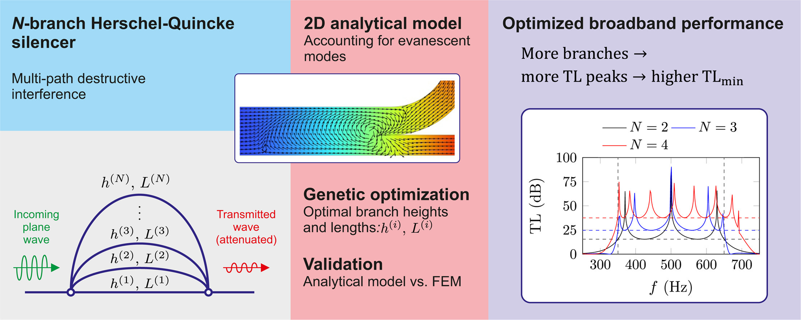

# MATLAB codes for article "On the silencing performance of $N$-branch arrangement of Herschel-Quincke tube"

This MATLAB code can be used to calculate the transmission loss of a multi-branch Herschel-Quincke silencer. 

The algorithm is described in article: Milan Cervenka, On the silencing performance of N-branch arrangement of Herschel–Quincke tube,
Journal of Sound and Vibration 650 (2027) 120259.

  

[Link to the open-access article in Journal of Sound and Vibration](https://doi.org/10.1016/j.jsv.2026.120259)

Specifically, the script *runme.m* calculates the transmission loss of 2-branch, 3-branch, and 4-branch silencer optimized for the frequency range 350Hz-650Hz.  Figure 13 from the article is generated.

Author: [Milam Cervenka](https://phys.fel.cvut.cz/en/person/?who=cervenm3&jaz=en), <milan.cervenka@fel.cvut.cz>

